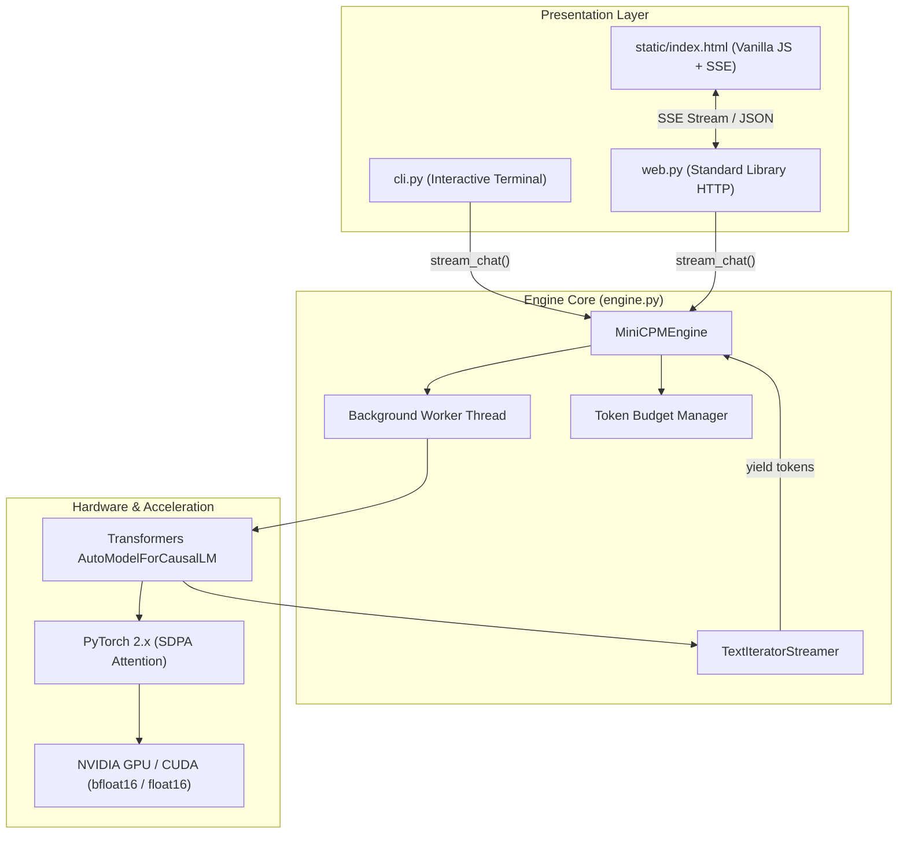
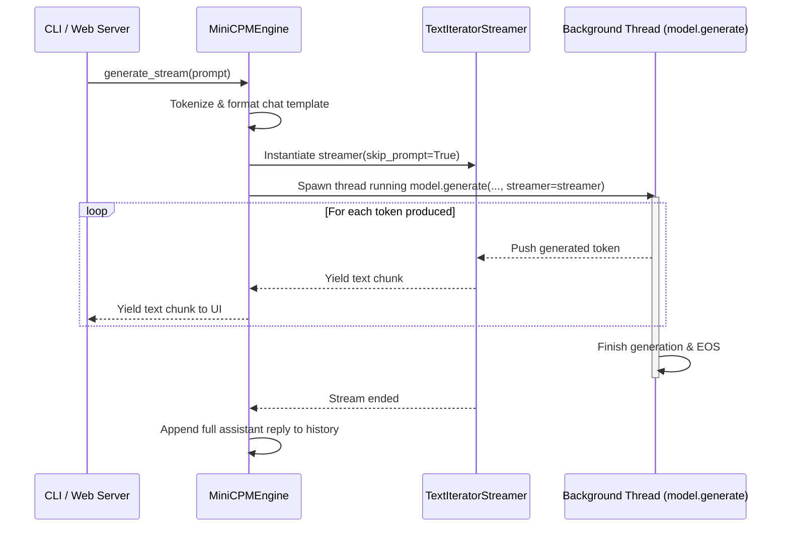

# Architecture Overview

This document provides a technical deep-dive into the architectural design of **localAI**, explaining how the inference engine was decoupled from user interfaces to maximize performance and minimize memory usage on consumer hardware.

---

## 1. Architectural Philosophy: Decoupled & Zero-Bloat

When running large language models locally on consumer hardware (such as laptops with 4 GB VRAM), system resources are precious:
- The 1B model weights in 16-bit precision consume ~2.2 GB of VRAM.
- KV Cache and context tokens consume another 300–800 MB.
- This leaves less than 1 GB of headroom on a 4 GB card (e.g., GTX 1650).

Conventional local AI wrappers use heavy web frameworks like **Streamlit** or **Gradio**, or full-stack Node.js/React servers. These frameworks consume **200–400 MB of extra RAM**, run heavy file-watcher threads, and frequently re-render or re-instantiate components, inducing CPU/GPU latency spikes.

**localAI solves this by enforcing two core architectural rules:**
1. **Decoupled Engine Core**: The model lifecycle, token budgeting, and inference logic are encapsulated in a standalone engine (`engine.py`) that yields raw text tokens as a Python generator.
2. **Standard Library Presentation**: Both the CLI and Web interfaces are thin presentation layers that consume this generator. The web server uses Python's built-in `http.server`, consuming **under 5 MB of RAM** with zero third-party web dependencies.

---

## 2. System Architecture Diagram

---

## 3. Component Breakdown

### A. The Core Inference Engine (`engine.py`)

The `MiniCPMEngine` class is responsible for:
- **Precision Detection**: Automatically checks GPU capabilities via `torch.cuda.is_bf16_supported()`. If supported, it uses `torch.bfloat16`; otherwise, it falls back to `torch.float16` or `float32`.
- **Attention Acceleration**: Loads the model with `attn_implementation="sdpa"` (Scaled Dot-Product Attention) to accelerate prompt prefill and lower peak memory.
- **Token-Budgeted Memory**: Maintains conversation state and trims history based on token count rather than turn count, preventing unexpected Out-Of-Memory (OOM) errors.
- **Generator-Based Streaming**: Instead of printing directly to standard out, it exposes `generate_stream(prompt)` which yields string chunks as they are generated.

### B. The Streaming Pipeline (`TextIteratorStreamer`)

In standard PyTorch generation, `model.generate()` is a blocking call that completes the entire response before returning. To achieve real-time streaming without blocking the main event loop:

### C. Terminal CLI (`cli.py`)

A zero-overhead terminal chat loop that handles user inputs and commands:
- `mode`: Toggles between step-by-step Thinking Mode and Fast Mode on the fly.
- `clear`: Wipes the chat history and triggers CUDA cache cleanup.
- `exit` / `quit`: Gracefully terminates the session.
- CLI argument parsing (`--model`, `--thinking`, `--max-tokens`, `--context-budget`).

### D. Zero-Dependency Web Server (`web.py` & `static/index.html`)

Instead of requiring FastAPI or Flask:
1. **Server (`web.py`)**: Subclasses `http.server.BaseHTTPRequestHandler` using `ThreadingHTTPServer`. It handles:
   - `GET /`: Serves `static/index.html`.
   - `POST /api/chat`: Streams tokens using the standard **Server-Sent Events (SSE)** protocol (`text/event-stream`).
   - `POST /api/clear`: Clears conversation memory.
   - `GET /api/status` & `POST /api/mode`: Inspects and toggles thinking mode.
   - Includes a thread lock to ensure safe serialized generation on single-GPU hardware.
2. **Frontend (`static/index.html`)**: A single lightweight file containing:
   - Vanilla JavaScript using native `fetch()` and `ReadableStreamDefaultReader` to parse incoming SSE chunks.
   - Live parsing of `<think>` and `</think>` tags into collapsible thought-process blocks.
   - Modern dark mode styling with zero external fonts, frameworks, or CDN dependencies.

---

## 4. Launchers & Path Resolution (`minicpm` & `minicpm-web`)

To allow execution from any directory on the host machine without having to manually activate the virtual environment:
- Shell wrapper scripts [`minicpm`](../minicpm) and [`minicpm-web`](../minicpm-web) use `readlink -f "${BASH_SOURCE[0]}"` to resolve the actual project path regardless of symlink locations.
- These scripts invoke `/path/to/minicpm-env/bin/python3` directly, making the system independent of active terminal environments.
